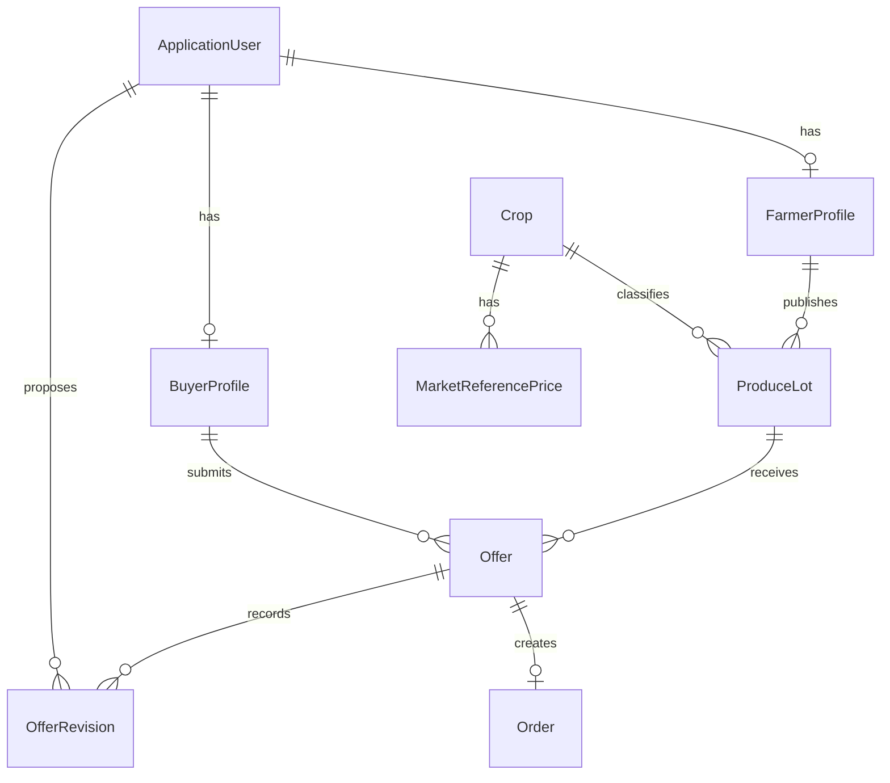

# BhaavBridge — Database Design

This is the agreed first-release relational design for the INT402 submission. The database uses SQL Server and Entity Framework Core. All quantities are stored in quintals and all prices/costs are in INR.

## 1. First-release business decisions

To keep the first release implementable and testable:

1. A produce lot is sold as one complete lot. Partial offers and partial acceptance are out of scope.
2. A buyer may have only one active offer for a given lot at a time. A rejected or withdrawn offer may be followed by a new offer.
3. Counteroffers update the current offer terms and create an `OfferRevision` record. The complete negotiation history is retained.
4. Only one offer can be accepted for a lot. Accepting it closes the lot and creates exactly one order.
5. An accepted offer cannot be replaced by another accepted offer. Re-listing and reselling a completed/closed lot are out of scope.
6. Farmer-borne costs for Net Daam are transportation, loading/handling and other farmer-borne expenses. The current values are stored with the offer and copied into the order as a snapshot.
7. Reference market prices are entered and maintained by an administrator. Each record stores its effective date and source; values are not presented as live or automatically updated.
8. Profile names and phone numbers are held in ASP.NET Identity where appropriate. Role-specific profile tables store only additional farmer/buyer details.
9. Commercial records are not hard-deleted. Draft lots without offers may be deleted; published lots are closed instead of deleted.
10. Status values are stored as strings through EF Core enum conversions so the database values remain readable.

## 2. Entity inventory

### ApplicationUser
Extends ASP.NET Core Identity `IdentityUser`. Holds authentication fields, email, phone number and `FullName`. Passwords are handled only by Identity.

### FarmerProfile
- `FarmerProfileId` — PK
- `UserId` — unique FK to ApplicationUser
- `Village`, `District`, `State`
- Optional `FarmName`

### BuyerProfile
- `BuyerProfileId` — PK
- `UserId` — unique FK to ApplicationUser
- `BusinessName`, `ContactPerson`, `Address`, `District`, `State`

### Crop
- `CropId` — PK
- `Name` — required, unique
- `Category` — optional
- `IsActive` — default true

### ProduceLot
- `ProduceLotId` — PK
- `FarmerProfileId` — FK
- `CropId` — FK
- `Variety`, `QualityGrade`
- `QuantityQuintals` — decimal(12,3), greater than zero
- `HarvestDate`
- `District`, `State`
- `AskingPricePerQuintal` — decimal(18,2), non-negative
- `Description`
- `Status` — Draft, Published or Closed
- `CreatedAtUtc`, `UpdatedAtUtc`

### MarketReferencePrice
- `MarketReferencePriceId` — PK
- `CropId` — FK
- `MarketName`, `District`, `State`
- `EffectiveDate`
- `MinimumPrice`, `MaximumPrice` — nullable decimal(18,2)
- `ModalPrice` — decimal(18,2)
- `SourceName` — required
- `SourceUrl` — optional
- `RecordedAtUtc`

### Offer
- `OfferId` — PK
- `ProduceLotId` — FK
- `BuyerProfileId` — FK
- `CurrentPricePerQuintal` — decimal(18,2), non-negative
- `QuantityQuintals` — decimal(12,3); equals the complete lot quantity
- `TransportationCost`, `LoadingCost`, `OtherFarmerCost` — decimal(18,2), non-negative
- `Message` — optional
- `Status` — Pending, Countered, Accepted, Rejected or Withdrawn
- `CreatedAtUtc`, `UpdatedAtUtc`

### OfferRevision
- `OfferRevisionId` — PK
- `OfferId` — FK
- `RevisionNumber` — sequential per offer
- `ProposedByUserId` — FK to ApplicationUser
- Proposed price, quantity and farmer-cost fields copied from the submitted proposal
- `Message` — optional
- `CreatedAtUtc`

The first buyer offer is also saved as revision 1. Every subsequent counteroffer creates the next revision; the `Offer` row stores the currently active terms.

### Order
- `OrderId` — PK
- `OfferId` — unique FK (one order per accepted offer)
- `AgreedQuantityQuintals`
- `AgreedPricePerQuintal`
- `GrossValue`
- `TransportationCostSnapshot`, `LoadingCostSnapshot`, `OtherFarmerCostSnapshot`
- `TotalFarmerCostsSnapshot`
- `EstimatedNetReturnSnapshot`
- `Status` — Placed, Confirmed, ReadyForPickup, Completed or Cancelled
- `CreatedAtUtc`, `UpdatedAtUtc`

The order reads the associated lot, farmer and buyer through its Offer. The agreed values and cost snapshots are stored on the order so later changes to the offer do not rewrite the transaction record.

## 3. Relationships

- ApplicationUser 1 — 0..1 FarmerProfile.
- ApplicationUser 1 — 0..1 BuyerProfile.
- FarmerProfile 1 — many ProduceLot.
- Crop 1 — many ProduceLot.
- Crop 1 — many MarketReferencePrice.
- ProduceLot 1 — many Offer.
- BuyerProfile 1 — many Offer.
- Offer 1 — many OfferRevision.
- ApplicationUser 1 — many OfferRevision (as proposer).
- Offer 1 — 0..1 Order.

## 4. Integrity rules and indexes

- Use SQL Server `decimal` types; do not use float/double for quantities, money or costs.
- Quantity must be greater than zero.
- Prices and cost values must not be negative.
- Foreign keys prevent orphaned profiles, lots, offers, revisions and orders.
- Only the owning farmer may manage a lot; only its submitting buyer may manage their offer.
- A closed lot cannot receive a new offer.
- Application logic permits only one active offer per buyer/lot pair.
- A SQL Server filtered unique index on `Offer.ProduceLotId` for `Status = 'Accepted'` enforces at most one accepted offer per lot.
- `Order.OfferId` is unique.
- `OfferRevision(OfferId, RevisionNumber)` is unique.
- `Crop.Name` is unique.
- Use restrictive delete behavior for lots/offers/orders and their history; do not cascade-delete transaction records.

## 5. Net Daam calculation

- Gross value = current offer price per quintal × offered quantity.
- Total farmer-borne cost = transportation + loading/handling + other farmer-borne expenses.
- Estimated Net Daam = gross value − total farmer-borne cost.
- Estimated Net Daam per quintal = estimated net return ÷ quantity.

Use decimal arithmetic. Copy the values used at acceptance into the order snapshot. Net Daam is an estimate and not a guarantee of actual proceeds.

## 6. EF Core implementation conventions

- Use `ApplicationDbContext : IdentityDbContext<ApplicationUser>`.
- Configure relationships, precision, indexes and check constraints through Fluent API.
- Store enum statuses as bounded strings.
- Use UTC timestamps.
- Use EF Core migrations for schema creation and changes.
- The initial migration must create the Identity tables and all BhaavBridge tables.
- Seed only non-sensitive crop/reference/demo values; do not seed user passwords or personal data.

## 7. First migration checklist

- [ ] Install EF Core SQL Server and Design packages.
- [ ] Register ApplicationDbContext and Identity services.
- [ ] Confirm the development SQL Server connection.
- [ ] Add the initial migration.
- [ ] Apply the migration to `BhaavBridge_Dev`.
- [ ] Verify tables, foreign keys and indexes in SSMS.
- [ ] Test one sample crop and a sample lot through EF Core.
